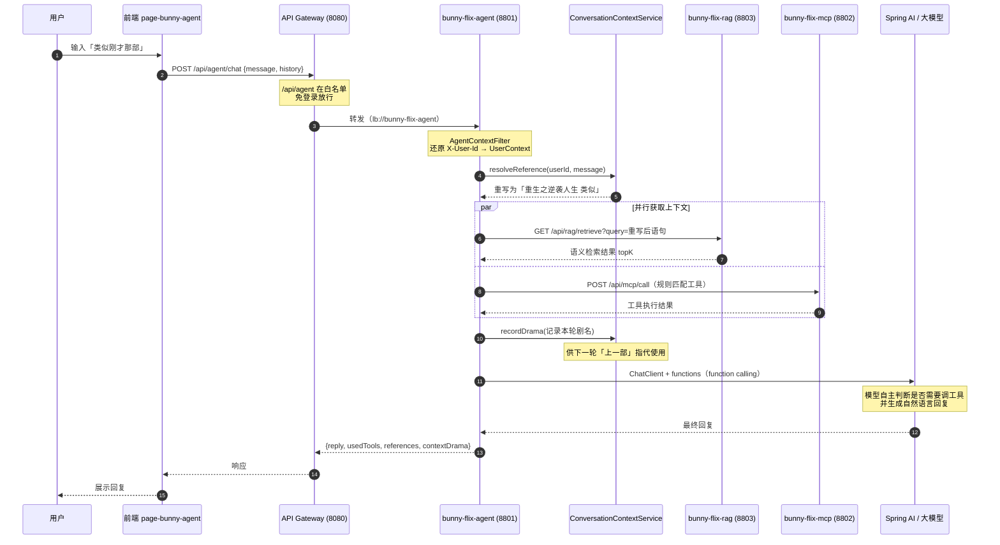
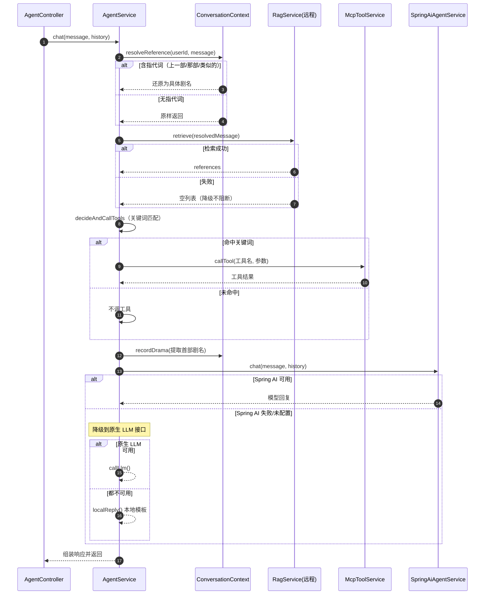
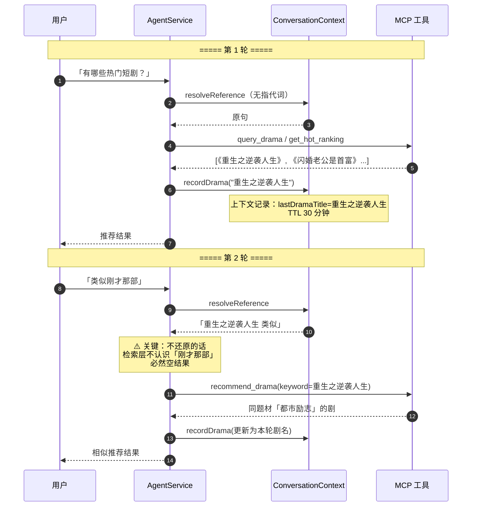
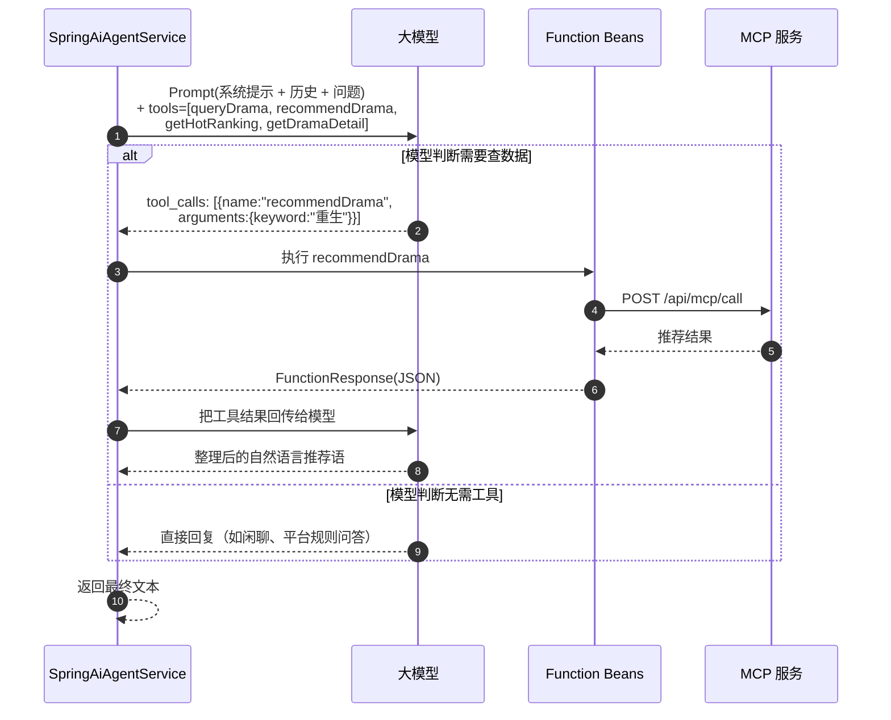
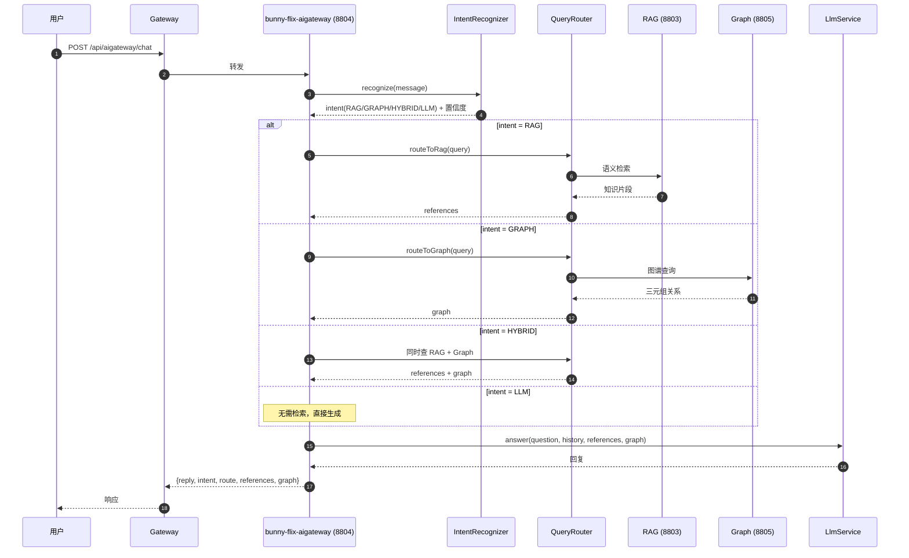
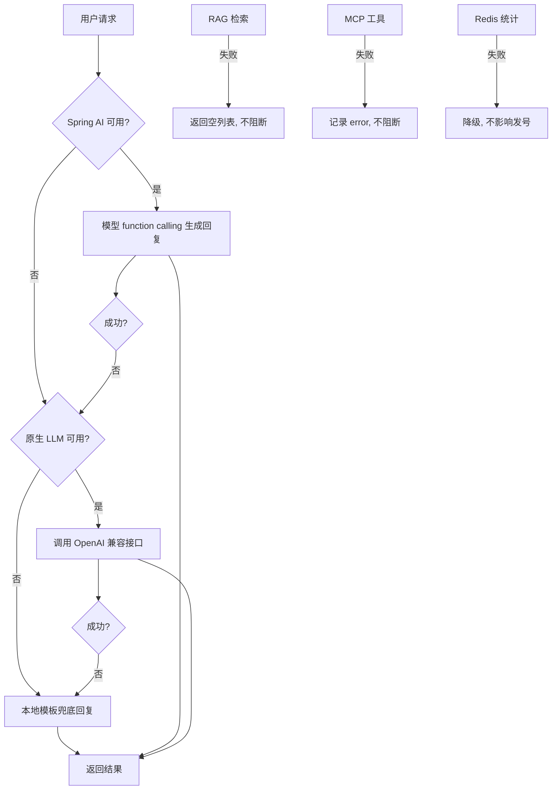

# AI 对话服务 —— 时序图

> 服务：`bunny-flix-agent`(8801) / `bunny-flix-mcp`(8802) / `bunny-flix-rag`(8803)
> / `bunny-flix-aigateway`(8804) / `bunny-flix-graph`(8805)
> 前端：`page-bunny-agent`(5176)
>
> 用支持 Mermaid 的 Markdown 编辑器（Typora / VSCode 插件 / GitHub）打开可直接渲染。

---

## 一、整体架构时序图（一次完整对话）

---

## 二、AgentService 内部处理时序（细化）

---

## 三、多轮上下文时序（体现「上一部」）

---

## 四、Spring AI function calling 时序（模型自主选工具）

**关键**：工具描述（`withDescription`）决定模型能否选对工具，这是"SKILL"的本质——不需要训练专用模型。

---

## 五、AI 网关版时序（第二套编排，偏知识问答）

**两套编排的定位差异**：
- `bunny-flix-agent`：偏**工具调用型**对话（查剧、推荐、榜单）
- `bunny-flix-aigateway`：偏**知识问答型**对话（意图 → RAG/图谱）

---

## 六、降级链路总览

**设计原则**：旁路依赖故障不阻断主流程。详见 `消息中间件旁路降级隐患.md`。

---

## 七、服务端口对照

| 服务 | 端口 | 时序图中的角色 |
|---|---|---|
| `page-bunny-agent` | 5176 | 前端 |
| `bunny-flix-gateway` | 8080 | 网关（白名单放行 /api/agent） |
| `bunny-flix-agent` | 8801 | 对话编排主服务 |
| `bunny-flix-mcp` | 8802 | 工具服务（6 个工具） |
| `bunny-flix-rag` | 8803 | 语义检索 |
| `bunny-flix-aigateway` | 8804 | 第二套编排 |
| `bunny-flix-graph` | 8805 | 知识图谱 |

---

*文档生成时间：2026-09-12*
*配套：`AI对话服务拆解.md`、`面试.md`*
